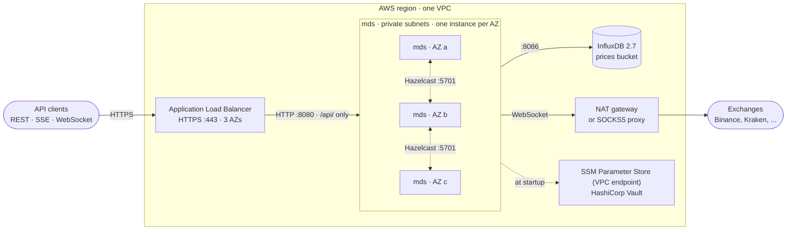
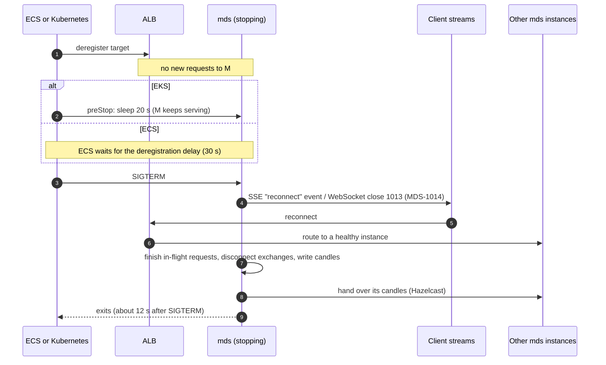
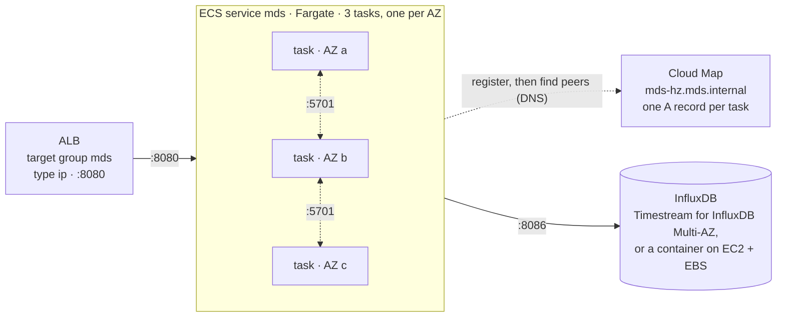
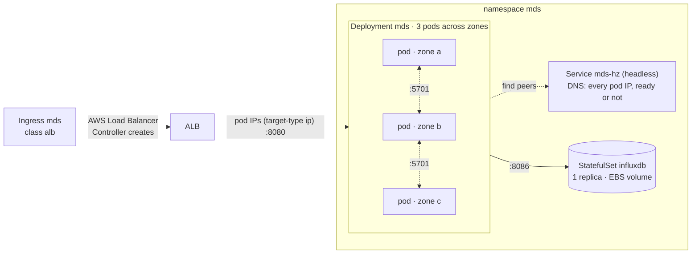

# Deploying mds

How to run mds in production on AWS with high availability: several instances behind an
Application Load Balancer (ALB), with InfluxDB alongside. Both mds and InfluxDB run as containers.
There are two options:

- **[Option A: ECS on Fargate](#option-a-ecs-on-fargate):** fewer moving parts. Choose this unless
  you already run Kubernetes.
- **[Option B: Kubernetes (EKS)](#option-b-kubernetes-eks):** for teams that already run EKS.

Both share the [load balancer settings](#load-balancer) and the [timeouts](#timeouts), which must
agree with the settings in mds's web server.

Ready-made files are in [`deploy/`](../deploy): Kubernetes manifests in `deploy/k8s/` and ECS
definitions in `deploy/ecs/`. Values to replace are marked `CHANGE`. This guide is for DevOps
engineers; the README covers how mds works ("Running several instances", "Configuration and
secrets").

## Contents

- [The deployment model](#the-deployment-model)
- [What survives what](#what-survives-what)
- [Container images](#container-images)
- [Load balancer](#load-balancer)
- [Timeouts](#timeouts)
- [Stopping an instance](#stopping-an-instance)
- [Option A: ECS on Fargate](#option-a-ecs-on-fargate)
- [Option B: Kubernetes (EKS)](#option-b-kubernetes-eks)
- [Choosing between them](#choosing-between-them)
- [InfluxDB](#influxdb)
- [Before going live](#before-going-live)

## The deployment model



- **Three mds instances, one per availability zone (AZ).** They form an embedded Hazelcast cluster
  that holds the in-progress candles with a backup on another instance. Each pair is owned by one
  instance, which builds its candles and archives its prices.
- **Any instance serves any client.** Every instance streams every exchange, so the ALB can send a
  request or stream anywhere. No sticky sessions. Instances that carry more than their share of
  streams send some clients elsewhere (README "Spreading subscribers").
- **InfluxDB** holds the price history and completed candles. The open-source version runs as one
  instance; see [InfluxDB](#influxdb) for a standby in another AZ.
- **Settings and secrets** are read once at startup, from SSM Parameter Store and Vault, over the
  private network.
- **Production mode** (`MDS_MODE=production`, set in `deploy/`) refuses to start with settings that
  are unsafe in production, such as the development InfluxDB token or text logs (README
  "Production mode"). Exchange traffic leaves through a NAT gateway, or through the SOCKS5 proxy where
  that is required (`MDS_SOCKS_PROXY_HOST`).
- **Only the ALB is public.** Only `/api/` is routed; `/actuator` (health details, metrics) is
  reachable only inside the VPC.

Three instances is the smallest count that survives losing an AZ with capacity to spare. Each
instance is sized for the whole load (`mds.stream.max-subscribers`, 1000 by default), so two can
carry everything while the third is replaced.

## What survives what

| Failure | Effect on clients | Effect on data |
|---|---|---|
| One instance stops (deploy, scale-in) | Its streams get a `reconnect` event (SSE) or close code 1013 (WebSocket) and reconnect to another instance at once | None: it hands its candles to the others before it exits |
| One instance or AZ fails abruptly | Its streams drop; clients reconnect (SSE by itself). The ALB stops routing to it within 30 s | None: the backups take over and the candles continue. Prices that arrive during the move, a second or two, may be missing from a candle's high and low |
| Two instances fail at once | As above | Pairs whose candle and backup were both on them reload from InfluxDB, losing at most one flush interval (10 s) |
| InfluxDB is down | Real-time prices and current candles keep working; history requests get 502 | Completed candles wait in the cluster and are written when it's back ([MDS-3103](runbook.md#mds-3103)); price snapshots taken meanwhile are lost ([MDS-3102](runbook.md#mds-3102)). Don't restart instances until it's back: a new one can't reload its candles ([MDS-3104](runbook.md#mds-3104)) |
| An exchange is down | Its prices drop out of the aggregate; the others carry on | Its per-exchange candles pause |
| SSM or Vault is down | None for running instances | New instances refuse to start ([MDS-1013](runbook.md#mds-1013)), so a deploy stalls and rolls back |

## Container images

**mds:** Spring Boot builds an OCI image with Cloud Native Buildpacks. No Dockerfile is needed:

```bash
./gradlew bootBuildImage --imageName=123456789012.dkr.ecr.ap-southeast-2.amazonaws.com/mds:1.1.0
docker push 123456789012.dkr.ecr.ap-southeast-2.amazonaws.com/mds:1.1.0
```

- **Tag images with the release version** (from the GitHub release that semantic-release
  publishes), never `latest`, so a deploy names exactly what it runs and a rollback is a tag
  change.
- **The architecture is the build machine's**: a Mac with Apple silicon builds `arm64`, which suits
  Graviton (cheaper). For `x86_64`, build on an `x86_64` machine or CI runner and set
  `cpuArchitecture` (ECS) or the node type (EKS) to match.
- **The image is minimal**: no shell, `curl` or package manager, and it runs as user `1002:1001`.
  So container health checks inside the image aren't possible (the load balancer and Kubernetes
  probes check over HTTP instead), and Kubernetes uses the built-in `sleep` action for `preStop`.
- **The JVM heap is sized from the container's memory limit**: about the limit minus 650 MiB
  (thread stacks, code cache, metaspace). 1.5 GiB gives about 870 MiB of heap. Below 1 GiB the heap
  is too small and mds stops with `OutOfMemoryError` at startup. Three instances use about 200 MiB
  of heap each at rest.
- **Set `BPL_JAVA_NMT_ENABLED=false`**: otherwise the image prints a native-memory report to stdout
  at exit, which breaks the one-JSON-object-per-line logs. The files in `deploy/` set it.

**InfluxDB:** the official `influxdb:2.7` image. Pin the minor version, and upgrade deliberately
after a backup.

## Load balancer

One internet-facing ALB in the public subnets of three AZs, in front of both options.

**Listeners and rules**

- **HTTPS :443** with an ACM certificate and the TLS policy `ELBSecurityPolicy-TLS13-1-2-2021-06`.
  **HTTP :80** only redirects to HTTPS.
- **Rule:** path `/api/*` forwards to the mds target group. The **default action** returns a fixed
  404, so `/actuator` and anything else is never exposed.
- **HTTP/2 to clients** stays on (the default). Browsers then carry many SSE streams over one
  connection, instead of six per host over HTTP/1.1.

**Target group**

| Setting | Value | Why |
|---|---|---|
| Target type | `ip` | Fargate tasks and EKS pods (with `target-type: ip`) are addressed directly |
| Protocol, port | HTTP, 8080 | TLS ends at the ALB |
| Protocol version | `HTTP1` (default) | mds speaks HTTP/1.1, and WebSocket upgrades need it |
| Algorithm | `least_outstanding_requests` | An open SSE stream is an outstanding request, so new streams go to the instances with fewer. The ALB has no least-connections mode; mds's rebalancer evens out the rest |
| Stickiness | off | Any instance serves any client, and stickiness would undo rebalancing |
| Slow start | off | Not supported with least outstanding requests; a new instance is ready when it says so |
| Deregistration delay | 30 s | See [Timeouts](#timeouts) |
| Health check path | `/actuator/health/readiness` | Up once the instance has joined the cluster, recovered its candles and connected to the exchanges; down as soon as it starts stopping |
| Health check interval, timeout | 10 s, 5 s | |
| Healthy, unhealthy thresholds | 2, 3 | In service 20 s after it's ready; out of service 30 s after it fails |
| Success codes | 200 | |

Readiness deliberately doesn't include InfluxDB: if InfluxDB fails, every instance would turn
unhealthy at once, while real-time streams still work. Watch InfluxDB with its own alert
(`GET /actuator/health` shows `components.influx` inside the VPC).

**Load balancer attributes**

| Attribute | Value |
|---|---|
| `idle_timeout.timeout_seconds` | 120 |
| `routing.http.drop_invalid_header_fields.enabled` | true |
| `client_keep_alive.seconds` | 3600 (default) |

Add AWS WAF with a rate-based rule if the API is public; mds limits streams per instance, not
requests per client.

## Timeouts

The ALB and mds's web server (Tomcat) must agree, or clients see 502s and dropped streams. Every
value here is set in `deploy/` and `application.yml`:

```
stream heartbeat (30 s)  <  ALB idle timeout (120 s)  <  mds keep-alive (130 s)
preStop sleep (20 s, EKS)  <  deregistration delay (30 s)
SIGTERM to exit (about 12 s measured)  <  shutdown phase limit (30 s)  <  stop timeout (60 s ECS, 75 s EKS)
```

| Setting | Where | Value | Why |
|---|---|---|---|
| **Stream heartbeat** | `mds.stream.heartbeat` (`MDS_STREAM_HEARTBEAT`) | **30 s** | Every open stream gets an SSE comment or a WebSocket ping this often, whether or not prices are flowing, so no stream is ever silent for longer |
| **ALB idle timeout** | ALB attribute | **120 s** | Closes a connection after this long with no data either way. Four heartbeat intervals, so one late heartbeat (a busy instance, a slow client) doesn't cost a connection. The ALB's 60 s default would also work with the heartbeat; 120 s leaves margin |
| **Keep-alive** | `server.tomcat.keep-alive-timeout` (`MDS_SERVER_KEEP_ALIVE_TIMEOUT`) | **130 s** | Must be **longer** than the ALB idle timeout, so the ALB always closes idle connections first. Otherwise the ALB can send a request on a connection Tomcat is closing at that moment, and the client gets a 502. Tomcat's default is 60 s, which equals the ALB's default: the classic cause of occasional 502s |
| **Stream lifetime** | `mds.stream.timeout` | 30 min | An SSE stream ends after this and the client reconnects (`EventSource` does so by itself), which also spreads clients across instances. It's also the WebSocket idle limit, but the ALB's 120 s comes first |
| **Deregistration delay** | target group | **30 s** | How long a stopping instance keeps its open connections after the ALB stops sending it new ones |
| **preStop sleep** | EKS pod spec | **20 s** | Kubernetes sends SIGTERM straight away, while the ALB may still route to the pod for a few seconds. Sleeping first keeps the pod serving until the ALB has stopped. ECS doesn't need it: it waits for the deregistration delay before sending SIGTERM |
| **Shutdown phase limit** | `spring.lifecycle.timeout-per-shutdown-phase` | 30 s | Upper limit for each shutdown step (finishing in-flight requests, disconnecting exchanges, writing candles) |
| **Stop timeout** | ECS `stopTimeout`; EKS `terminationGracePeriodSeconds` | **60 s; 75 s** | After this the container is killed. Measured: about 12 s from SIGTERM to exit. EKS adds the 20 s `preStop` |
| **Health check grace** | ECS `healthCheckGracePeriodSeconds`; EKS startup probe | 60 s; up to 3 min | mds is ready about 10 s after its container starts (measured on a laptop), longer on a cold Fargate task |

**Streams that go quiet:** when no exchange has a fresh price for a pair, or a client asked for a
slow rate, its stream carries no prices for a while. The heartbeat keeps it open: an SSE comment
line (`:heartbeat`, which `EventSource` ignores) and, on a WebSocket with at least one
subscription, a ping frame (answered by the browser or client library; page scripts never see it).
Clients should still reconnect on any close: `EventSource` does so by itself, and WebSocket clients
must handle close codes 1001, 1006 and 1013 by reconnecting and subscribing again. Any other proxy
in the path (a corporate proxy, nginx) needs an idle timeout above 30 s too.

## Stopping an instance

Deploys, scale-in and node maintenance stop instances one at a time. On SIGTERM mds closes every
real-time stream first ([MDS-1014](runbook.md#mds-1014)), so clients reconnect to another instance
while prices are still flowing. Then it disconnects from the exchanges, writes its candles and
hands its share of the cluster to the others.



## Option A: ECS on Fargate



**Files:** `deploy/ecs/task-definition.json` (`aws ecs register-task-definition --cli-input-json
file://...`) and `deploy/ecs/service.json` (`aws ecs create-service --cli-input-json file://...`).

**Task definition**

- **1 vCPU and 2 GiB** per task (about 1.3 GiB of heap). Platform `ARM64` (Graviton); change it if
  your image is `x86_64`.
- `stopTimeout: 60`, a read-only root filesystem with a scratch volume for `/tmp`, and logs to
  CloudWatch through `awslogs` in `non-blocking` mode. A logging hiccup then can't stall the
  service.
- **Vault login:** ECS has no service-account token, so the task uses AppRole. A short helper
  container reads the AppRole secret ID from Secrets Manager and writes it to a file that only
  mds can read (`MDS_VAULT_APP_ROLE_SECRET_ID_FILE`). The task execution role needs
  `secretsmanager:GetSecretValue` on that secret. Rotate the secret ID in Secrets Manager; new tasks
  pick it up.
- **The task role** allows `ssm:GetParametersByPath` on `/mds/prod/*`, and `kms:Decrypt` if you use
  SecureString parameters.

**Service**

| Setting | Value | Why |
|---|---|---|
| `desiredCount` | 3 | One per AZ; Fargate spreads tasks across the service's subnets |
| `minimumHealthyPercent`, `maximumPercent` | 100, 134 | One new task at a time (for 3 tasks: at most 4 running) and never fewer than 3 |
| `deploymentCircuitBreaker` | enabled, with rollback | A release that can't start (for example [MDS-1013](runbook.md#mds-1013)) rolls back by itself |
| `healthCheckGracePeriodSeconds` | 60 | Time to start before ALB health checks count |
| `availabilityZoneRebalancing` | `ENABLED` | Moves tasks back across AZs after an AZ recovers |
| `serviceRegistries` | the Cloud Map service below | How instances find each other |
| `assignPublicIp` | `DISABLED` | Tasks live in private subnets |

**How instances find each other:** a Cloud Map private DNS namespace (`mds.internal`) with a
service `mds-hz` that holds one A record per running task. mds looks up that name
(`MDS_CLUSTER_KUBERNETES_SERVICE_DNS=mds-hz.mds.internal`). Despite the setting's name, this is a
plain DNS lookup, the same one used for a Kubernetes headless Service:

```bash
aws servicediscovery create-private-dns-namespace --name mds.internal --vpc vpc-CHANGE
aws servicediscovery create-service --name mds-hz --namespace-id ns-CHANGE \
  --dns-config 'RoutingPolicy=MULTIVALUE,DnsRecords=[{Type=A,TTL=10}]' \
  --health-check-custom-config FailureThreshold=1
```

**The first deployment** starts with `desiredCount: 1`, then raises it to 3 once that task is
healthy. Tasks that start together can't yet see each other in DNS, and each would form its own
cluster until Hazelcast merges them (it checks every 30 s). Rolling updates always have running
tasks to join, so this applies only when starting from zero.

**Security groups**

| Group | Inbound | From |
|---|---|---|
| `alb` | 443, 80 | the internet (or your clients' ranges) |
| `mds` | 8080 | `alb` |
| `mds` | 5701 | `mds` itself: Hazelcast traffic is neither encrypted nor authenticated, so nothing else may reach it |
| `influxdb` | 8086 | `mds` |

Outbound from `mds`: the exchanges (through the NAT gateway or the SOCKS proxy), InfluxDB, Vault,
and the SSM, ECR, CloudWatch Logs and Secrets Manager VPC endpoints.

**ALB settings with the AWS CLI** (the names are what the console shows too):

```bash
aws elbv2 create-target-group --name mds --target-type ip --protocol HTTP --port 8080 \
  --vpc-id vpc-CHANGE --health-check-path /actuator/health/readiness \
  --health-check-interval-seconds 10 --health-check-timeout-seconds 5 \
  --healthy-threshold-count 2 --unhealthy-threshold-count 3 --matcher HttpCode=200
aws elbv2 modify-target-group-attributes --target-group-arn "$TG" --attributes \
  Key=deregistration_delay.timeout_seconds,Value=30 \
  Key=load_balancing.algorithm.type,Value=least_outstanding_requests
aws elbv2 modify-load-balancer-attributes --load-balancer-arn "$ALB" --attributes \
  Key=idle_timeout.timeout_seconds,Value=120 \
  Key=routing.http.drop_invalid_header_fields.enabled,Value=true
```

**Scaling:** keep a fixed count of 3 to start with. To scale on load, use target tracking on CPU
(around 60 %), and keep `mds.stream.max-subscribers` per instance in mind. Scale-in stops tasks
gracefully, as above.

## Option B: Kubernetes (EKS)



**Files:** `deploy/k8s/`, applied with `kubectl apply -k deploy/k8s` after you replace the `CHANGE`
values. Create the `influxdb-auth` Secret first (keys `username`, `password`, `token`), from Vault
through the External Secrets Operator or by hand. It never goes in git.

| Manifest | What it sets up |
|---|---|
| `namespace.yaml` | Namespace `mds`, labelled for the ALB controller's **pod readiness gates**: a new pod counts as ready only once the ALB sees it healthy, so a rolling update never gets ahead of the load balancer |
| `serviceaccount.yaml` | IAM role for SSM (IRSA, or an EKS Pod Identity association instead); its token is also the Vault login (`MDS_VAULT_AUTH=kubernetes`) |
| `configmap.yaml` | How to find configuration and peers; everything else comes from SSM and Vault |
| `deployment.yaml` | 3 replicas spread across zones; rolling update `maxSurge: 1, maxUnavailable: 0`; startup, liveness and readiness probes; `preStop` sleep 20 s; grace period 75 s; non-root with a read-only filesystem |
| `services.yaml` | `mds` for the ALB, and the headless `mds-hz` that instances use to find each other. It lists pods before they're ready (`publishNotReadyAddresses`), so pods that start together join one cluster |
| `pdb.yaml` | Node drains take one mds pod at a time |
| `networkpolicy.yaml` | Only mds pods reach 5701 and InfluxDB's 8086. Needs a CNI that enforces policies (the VPC CNI with network policy enabled, or Calico) |
| `ingress.yaml` | The ALB with the settings from [Load balancer](#load-balancer) and [Timeouts](#timeouts), as annotations |
| `influxdb.yaml` | InfluxDB as a one-replica StatefulSet with a 100 GiB volume; see [InfluxDB](#influxdb) |

**Probes**

- **Startup** probe: `/actuator/health/liveness`, checked for up to 3 minutes.
- **Liveness:** `/actuator/health/liveness`, so a hung JVM is restarted.
- **Readiness:** `/actuator/health/readiness`, which turns down as soon as shutdown starts.

Neither liveness nor readiness depends on InfluxDB or the exchanges, so an outage there never
restarts pods or takes them all out of the load balancer.

**Prerequisites:** the AWS Load Balancer Controller, the EBS CSI driver with a default storage class
(gp3), Kubernetes 1.30 or later (for the `preStop` sleep action), and a policy-enforcing CNI.

**Tested on a local cluster** (k3s 1.33, with an overlay that drops the Ingress, SSM and Vault). In
those tests:
- the three pods formed one cluster through the headless Service, and the network policies left
  cluster and InfluxDB traffic working;
- a rolling restart went one pod at a time;
- stopping a pod with an open SSE stream sent the client a `reconnect` event at SIGTERM, and the pod
  was gone 32 s after the delete (20 s of it the `preStop` sleep);
- after a pod was force-deleted, its pairs' candles continued on another pod with the same open,
  high and low.

The ALB, IRSA and Vault login weren't part of that test.

## Choosing between them

| | ECS on Fargate | EKS |
|---|---|---|
| To run | AWS-managed; no nodes or cluster upgrades | A cluster, node groups and add-ons to keep current |
| Peer discovery | Cloud Map DNS | Headless Service DNS |
| Vault login | AppRole, with the secret ID from Secrets Manager | The pod's service-account token |
| Graceful stop | ECS waits for the deregistration delay itself | Needs the `preStop` sleep |
| Hazelcast port isolation | Security group referencing itself | NetworkPolicy |
| InfluxDB | Timestream for InfluxDB, or EC2 with EBS (Fargate has no lasting block storage for a database) | StatefulSet on EBS, or Timestream for InfluxDB |
| Fits when | mds is the main thing you run, or your services are on ECS | You already run EKS with these add-ons |

## InfluxDB

InfluxDB 2.x open source runs as a **single instance**; it has no replication. Pick by how long you
can be without history:

| Option | Availability | Notes |
|---|---|---|
| **Amazon Timestream for InfluxDB, Multi-AZ** | Standby in another AZ, automatic failover | Recommended for production. Same InfluxDB 2 API: point `MDS_INFLUX_URL` at it and put its token in Vault |
| **Container on EBS** (EKS StatefulSet, or ECS on one EC2 instance with an EBS volume) | One AZ. A failed node is replaced, but if the AZ goes down, so does InfluxDB | Matches `docker-compose.yml`. Take EBS snapshots daily (Amazon Data Lifecycle Manager) and `influx backup` before upgrades |

Either way:

- **Give mds a token limited to the `prices` bucket** (read and write), not the admin token, and
  keep it in Vault as `mds.influx.token`.
- **The bucket keeps everything** (retention `0s`). Size the volume for growth, and alert on disk
  use.
- **Don't run InfluxDB on EFS** or another network file system; its storage engine expects a local
  disk.

## Before going live

- [ ] Image built from a release tag and pushed to ECR; the task definition or kustomization names
  that tag.
- [ ] `/mds/prod/` parameters in SSM and `mds/prod` secrets in Vault (README "Configuration and
  secrets"); the IAM role and Vault policy allow reading them.
- [ ] `MDS_MODE=production` is set, and the instances start (production mode refuses unsafe settings).
- [ ] Three instances in three AZs, and `GET /actuator/health` inside the VPC shows `members: 3`.
- [ ] ALB: HTTPS only, `/api/` only, idle timeout 120 s, target group health on
  `/actuator/health/readiness`, deregistration delay 30 s.
- [ ] Port 5701 reachable only from mds (security group or NetworkPolicy).
- [ ] Alerts: `mds.cluster.members` below 3, unhealthy target count above 0, InfluxDB health, and
  the [runbook's suggested alerts](runbook.md#finding-the-log-lines).
- [ ] InfluxDB backups (snapshots or Timestream automated backups), and a restore tried once.
- [ ] A rolling deploy tried with a client connected: it reconnects and keeps receiving prices.
